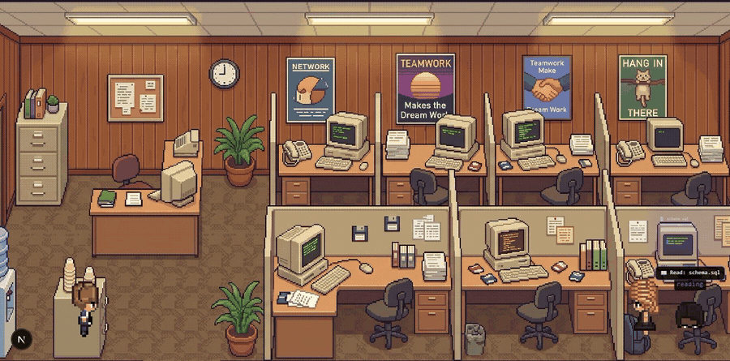
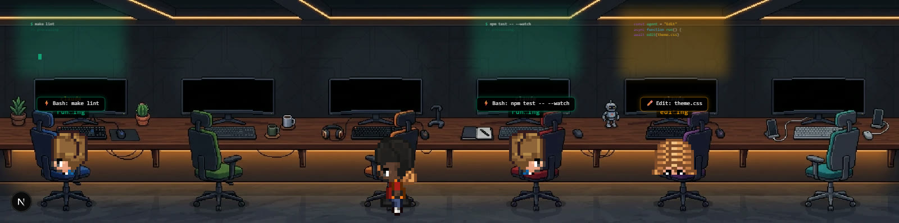
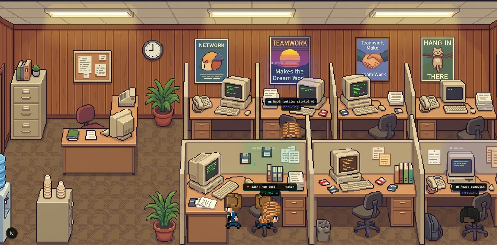
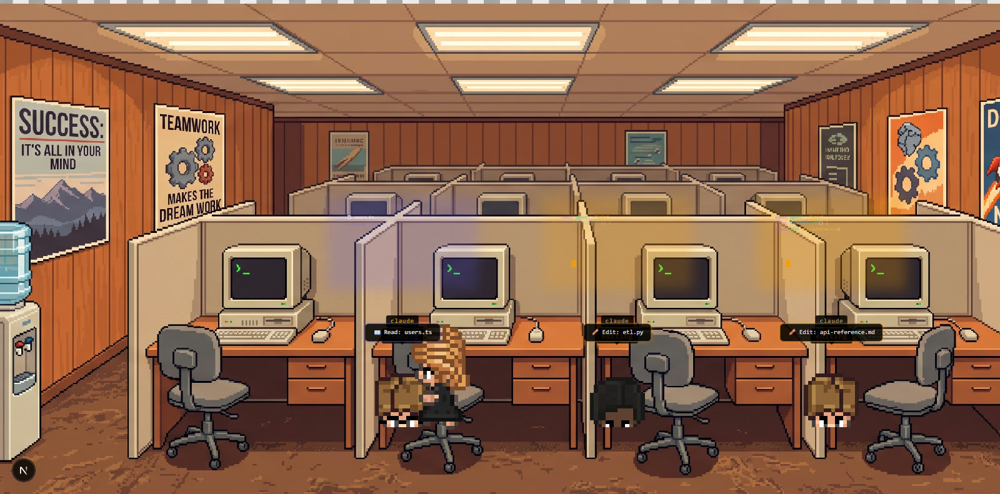
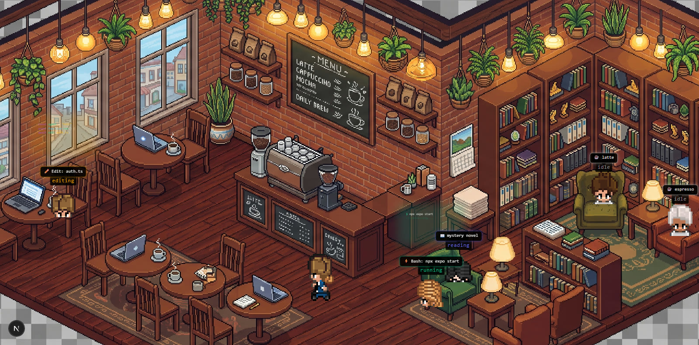
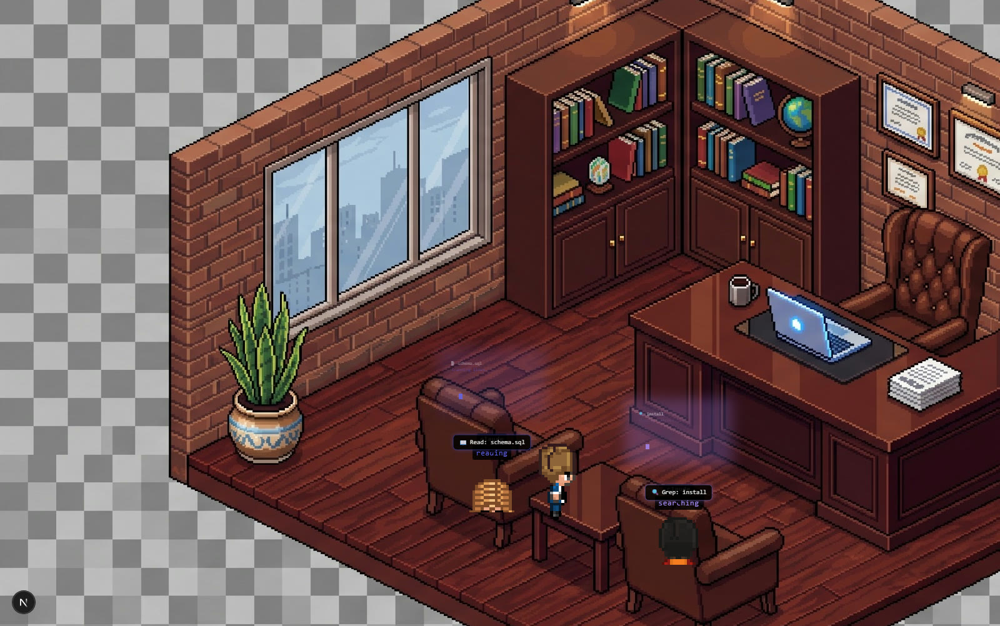
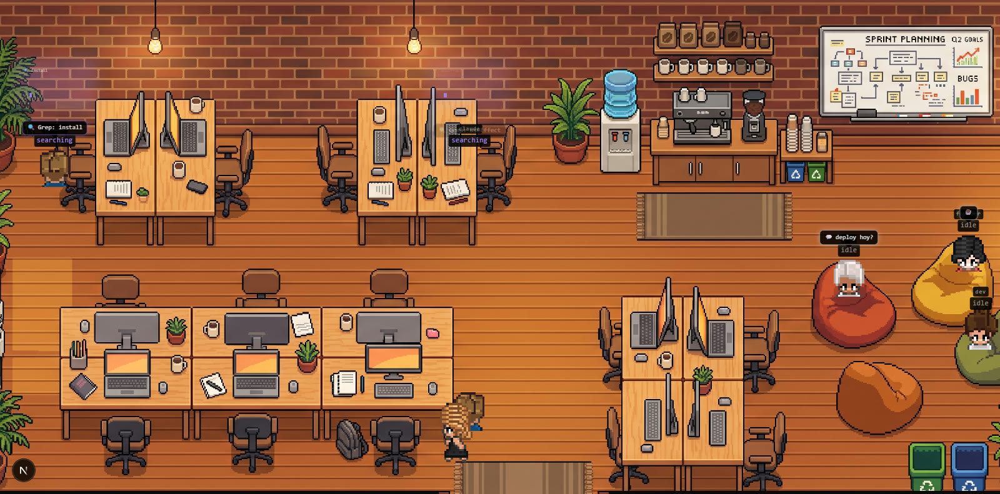
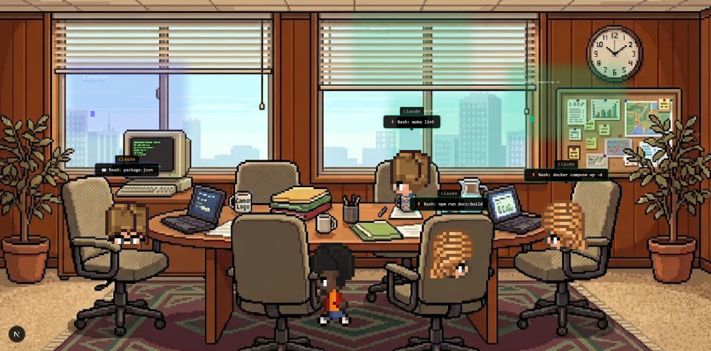

<div align="center">

# 🏢 Pixel Office

**Watch your AI coding agents live, as pixel-art characters in a retro office.**

*Walk to their desks, read files, edit code, run commands, think — all in real time, retro-game style.*

[](LICENSE)
[](https://nextjs.org)
[](https://www.electronjs.org)
[](https://www.typescriptlang.org)

[English](README.md) · [Español](README.es.md)

</div>

---



*Above: 5 agents working in the Retro Cubicles office. Each bubble shows what that agent is doing (`Read`, `Edit`, `Bash`, `Grep`, `Task`).*

---

## What is this?

Pixel Office is a **desktop app** that turns your AI coding agents into animated pixel-art characters sitting in a retro office. It reads your agent activity locally and renders it as a living scene: characters walk to their desks, sit down, type on their monitors, run commands, search code, and think — all in real time.

It works with **OpenCode** (reads the SQLite database) and **Claude Code** (reads session JSONL files). Both can run at the same time, each with its own main agent.

**No plugins. No hooks. No data leaves your machine.** It just reads local files.

## Themes

Seven office themes, each hand-calibrated (seats, scale, floor line, ambient characters):

| Theme | Preview |
|-------|---------|
| **Original Desk** |  |
| **Retro Cubicles** |  |
| **Retro Office** |  |
| **Cozy Café** |  |
| **Corporate Exec** |  |
| **Startup Cowork** |  |
| **Meeting Room** |  |

## Features

- **Live agents** — every active agent gets its own character with a stable identity (no ghosts, no duplicates)
- **Real-time animation** — characters walk to their desks, sit, type, run commands, search, think, and spawn sub-agents
- **Dual source** — reads OpenCode (SQLite) and Claude Code (JSONL) simultaneously; missing sources are simply skipped
- **Speech bubbles** — each agent shows what it's doing (tool + file/command)
- **7 office themes** — AI-generated backgrounds with hand-calibrated seats, scale and floor
- **Cast panel** (👥) — toggle ambient characters per spot, pick their look (P0–P9), wander mode, workers-only mode
- **Calibration mode** (📐) — drag seats and characters onto furniture, tune zoom/size live, restore defaults
- **Day/night clock** — overlay tint that follows your system time
- **Event log + token counter** — see agent activity and estimated cost
- **Building view** (🏢) — optional multi-floor overview: terrace, studio, servers, meeting room, lobby, café
- **Clean mode** (`?clean=1`) — office only, no panels (great for screenshots and wallpapers)

## Install

### Option A: Download the installer (Windows)

1. Go to [Releases](../../releases)
2. Download `Pixel Office Setup 1.0.0.exe`
3. Run it and follow the installer

> **Note:** Windows SmartScreen may show "App unrecognized" because the app isn't signed with a code-signing certificate (that costs $100+/year). Click **More info → Run anyway**. It's not a virus — it's just an unsigned indie app.

### Option B: Build from source

```bash
git clone https://github.com/Sebaspelusa/pixel-office.git
cd pixel-office
npm install
npm run build:exe
```

The installer lands in `dist/` (`Pixel Office Setup 1.0.0.exe`).

### Option C: Run in development

```bash
npm install
npm run dev
```

Open `http://localhost:3000/pixel-agents` — you'll see your agents live.

## Usage

1. **Open the app** — it starts reading your agent activity immediately
2. **Switch themes** — click the theme picker (top right) to choose your office
3. **Toggle the cast** — click 👥 to show/hide ambient characters
4. **Calibrate** — click 📐 to enter calibration mode (drag seats, tune zoom)
5. **Building view** — click 🏢 to show the multi-floor building overview
6. **Bubbles** — click 💬 to show/hide speech bubbles

### URL flags

| Flag | What it does |
|------|-------------|
| `?bg=<theme-id>` | Open a specific theme (e.g., `?bg=cozy-cafe`) |
| `?demo=1` | Demo mode (synthetic agents, no real data) |
| `?clean=1` | Office only, no panels (screenshots/wallpapers) |
| `?cal=1` | Calibration mode on load |

Theme IDs: `original-desk`, `retro-cubicles`, `retro-office`, `cozy-cafe`, `corporate-exec`, `startup-cowork`, `meeting-room`

### Port

The desktop app doesn't fight over ports: it tries `3014`, `3015`, `3016`, `3017`, `3018` and only falls back to `3000` if every one of them is taken. The active port shows in the window title — handy when another dev server already owns 3000.

If the server ever starts late (busy port at boot), the app keeps retrying and swaps to the real page instead of staying stuck on the error screen.

`npm run dev` (Option C) still uses Next.js' default `3000`.

## Configuration

| Env var | Default | What it does |
|---------|---------|-------------|
| `OPENCODE_DB` | `~/.local/share/opencode/opencode.db` | Path to the OpenCode SQLite database |
| `CLAUDE_DIR` | `~/.claude/projects` | Path to Claude Code session files |

No other setup needed — everything else (theme, background, cast, calibration) persists in `localStorage`.

## Privacy

**Pixel Office reads local files. It does not send data anywhere.**

- Reads `~/.local/share/opencode/opencode.db` (OpenCode activity)
- Reads `~/.claude/projects/*/*.jsonl` (Claude Code sessions)
- Listens on `127.0.0.1` only (no external network access)
- No telemetry, no analytics, no cloud

The installer contains **zero personal data** — it's just the app code, sprites and backgrounds.

## How it works

OpenCode stores sessions and tool activity in a local SQLite database. Claude Code writes JSONL session files. A Server-Sent Events endpoint (`api/pixel-agents/agents-stream`) polls both sources every 600ms and emits `snapshot` / `agent_update` / `agent_end` events with stable agent IDs (`main` for OpenCode, `claude-main` for Claude).

The frontend (`AgentDataContext`) keeps agent state. `DeskCanvas` renders the close-up office (sprites walk in, sit, work, fade out). `OfficeCanvas` renders the building overview. No plugins or hooks required.

## Project structure

```
src/app/
├── api/pixel-agents/
│   ├── agents-stream/route.ts   ← SSE endpoint (polls OpenCode SQLite + Claude JSONL)
│   └── broadcast/route.ts       ← public visibility toggle
└── pixel-agents/
    ├── AgentDataContext.tsx      ← SSE client + state management
    ├── BackgroundContext.tsx     ← office theme selection + persistence
    ├── ThemeContext.tsx          ← color themes
    ├── CastContext.tsx           ← ambient cast selection (👥)
    ├── CastSelector.tsx          ← cast panel UI
    ├── BackgroundSelector.tsx    ← theme picker UI
    ├── ThemeSelector.tsx         ← theme picker UI
    ├── DeskCanvas.tsx            ← close-up office (seats, sprites, CAL mode)
    ├── OfficeCanvas.tsx          ← multi-floor building (zones, wander)
    ├── DayNightOverlay.tsx       ← clock + day/night tint
    ├── EventLog.tsx              ← agent activity feed
    ├── TokenCounter.tsx          ← token usage
    ├── office-backgrounds.ts     ← per-theme seats / zoom / scale / ambient
    ├── layout.tsx
    └── page.tsx
electron/
└── main.js                       ← Electron shell (single instance, loader)
scripts/
├── prune-standalone.js           ← build helper (prunes unused Next.js files)
└── demo-agents.mjs               ← fake data generator (for demos/screenshots)
```

## Credits

- Original concept + pixel art sprites: [pablodelucca/pixel-agents](https://github.com/pablodelucca/pixel-agents) (MIT)
- Office backgrounds: AI-generated for this fork
- Built with [Next.js 16](https://nextjs.org), [Electron 36](https://www.electronjs.org), [Tailwind CSS 4](https://tailwindcss.com), [TypeScript 5](https://www.typescriptlang.org)

## License

MIT © Vasyl Pavlyuchok — see [LICENSE](LICENSE) (original notices preserved).

Modifications in this fork are also released under MIT.

---

<div align="center">

Made with 💜 by [Sebaspelusa](https://github.com/Sebaspelusa)

</div>
